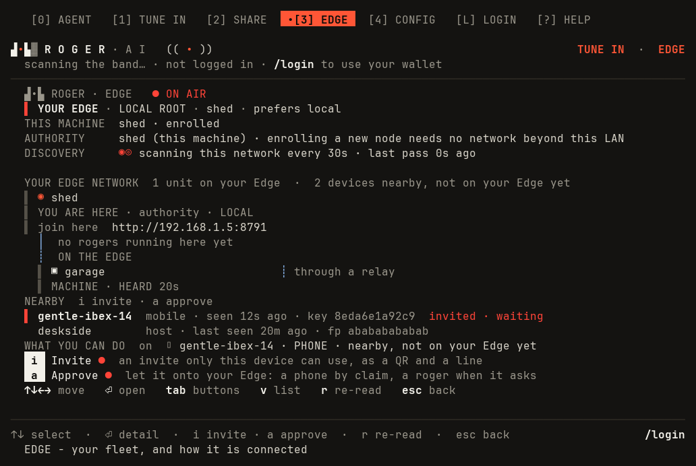
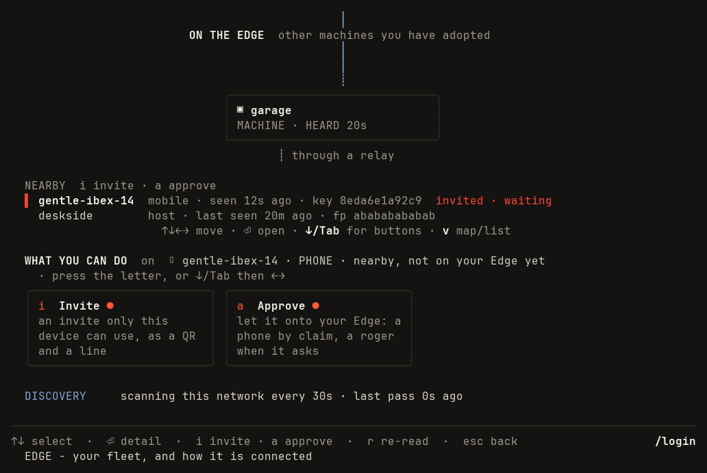
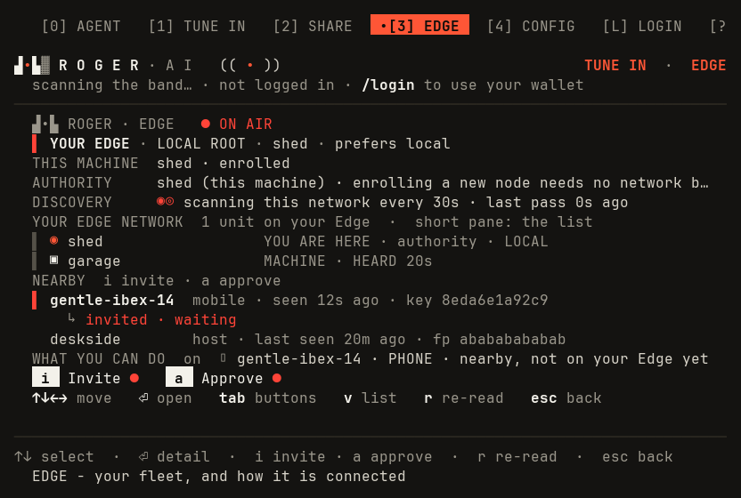
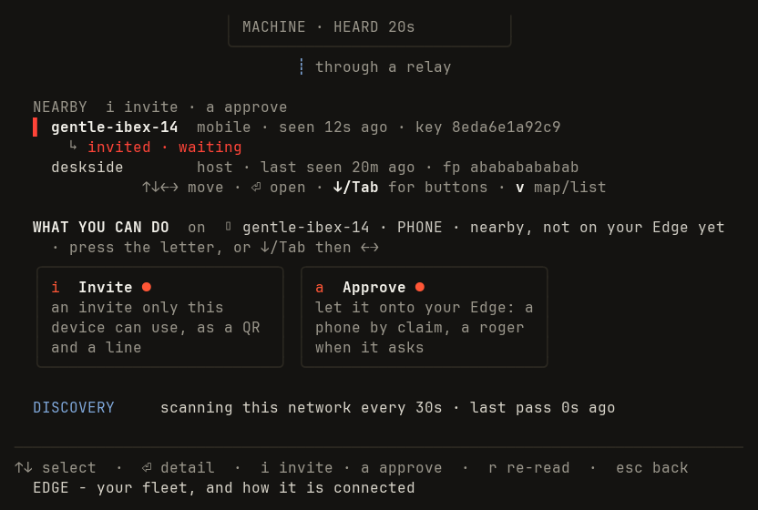
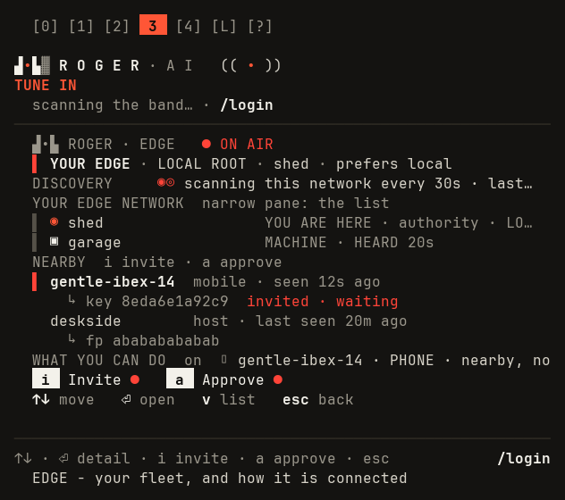
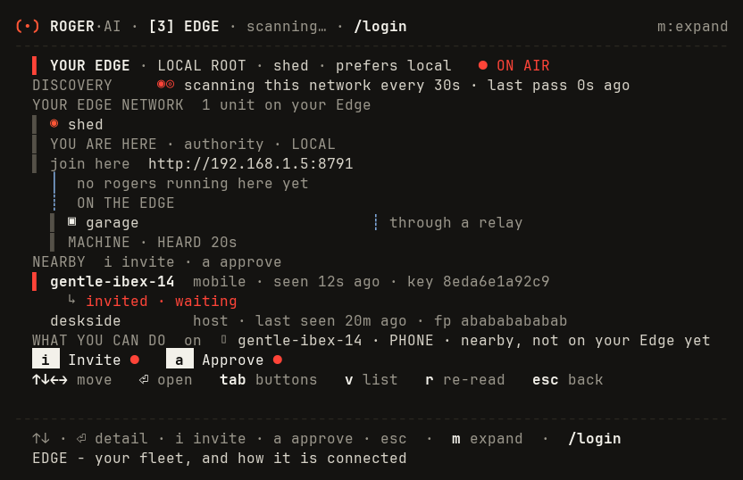

# Enrolled [3] EDGE: proposed look (mockups)

STATUS: APPROVED 2026-10-13 (founder, D1-D6 as recommended) and built (internal/tui/edge_enrolled_look.go). Spec:
`features/edge/enrolled_edge_look.feature`. This is the follow-up slice named in
`docs/welcome-and-empty-edge-mockups.md` ("Follow-up: enrolled [3] look", ruled 2026-10-11, R1).

How these were made: a throwaway test (never committed) rendered the TUI's own `View()` chrome
(preset bar, the big ROGER·AI brand, the footer) around a proposed body drawn with the real
`internal/look` palette and helpers, from the same fixture the NEARBY goldens use
(`internal/tui/edge_nearby_golden_test.go`: the authority "shed", one member "garage" reached
through a relay, two nearby devices, one invited). The "today" frames are the unmodified
`View()` of the same fixture at the same size. Colour frames are PNGs beside this file; the
text frames below are the NO_COLOR render.

Only the drawing changes. Every key, every selection rule, every action and every word an
owner acts on stays; the frames below select the nearby phone, so WHAT YOU CAN DO offers
Invite and Approve exactly as today.

## 100 x 30

Proposed: 

Today, same fixture: 

Proposed, NO_COLOR:

```text
   [0] AGENT   [1] TUNE IN   [2] SHARE   •[3] EDGE   [4] CONFIG   [L] LOGIN   [?] HELP

▟•▙▓ R O G E R · A I   (( • ))                                                      TUNE IN  ·  EDGE
  scanning the band… · not logged in · /login to use your wallet
────────────────────────────────────────────────────────────────────────────────────────────────────
  [*] ROGER . EDGE   ● ON AIR
  > YOUR EDGE · LOCAL ROOT · shed · prefers local
  THIS MACHINE  shed · enrolled
  AUTHORITY     shed (this machine) · enrolling a new node needs no network beyond this LAN
  DISCOVERY     @O scanning this network every 30s · last pass 0s ago

  YOUR EDGE NETWORK  1 unit on your Edge  ·  2 devices nearby, not on your Edge yet
  | ◉ shed
  | YOU ARE HERE · authority · LOCAL
  | join here  http://192.168.1.5:8791
    │  no rogers running here yet
    ┊  ON THE EDGE
    | ▣ garage                          ┊ through a relay
    | MACHINE · HEARD 20s
  NEARBY  i invite · a approve
  > gentle-ibex-14  mobile · seen 12s ago · key 8eda6e1a92c9  invited · waiting
    deskside        host · last seen 20m ago · fp abababababab
  WHAT YOU CAN DO  on  ▯ gentle-ibex-14 · PHONE · nearby, not on your Edge yet
  [i] Invite ●  an invite only this device can use, as a QR and a line
  [a] Approve ●  let it onto your Edge: a phone by claim, a roger when it asks
  ↑↓←→ move   ⏎ open   tab buttons   v list   r re-read   esc back

────────────────────────────────────────────────────────────────────────────────────────────────────
↑↓ select  ·  ⏎ detail  ·  i invite · a approve  ·  r re-read  ·  esc back                    /login
  EDGE - your fleet, and how it is connected```

Today, NO_COLOR. The full frame is taller than 30 rows, so the height backstop keeps the bottom 30: the
cabinet, the title, the counts and the hub card never reach a 30-row terminal.

```text
                                                │
                          ON THE EDGE  other machines you have adopted
                                                │
                                                │
                                                ┊
                               ╭──────────────────────────────╮
                               │ ▣ garage                     │
                               │ MACHINE · HEARD 20s          │
                               ╰──────────────────────────────╯
                                       ┊ through a relay

  NEARBY  i invite · a approve
  > gentle-ibex-14  mobile · seen 12s ago · key 8eda6e1a92c9  invited · waiting
    deskside        host · last seen 20m ago · fp abababababab
                      ↑↓←→ move · ⏎ open · ↓/Tab for buttons · v map/list

  WHAT YOU CAN DO  on  ▯ gentle-ibex-14 · PHONE · nearby, not on your Edge yet
  · press the letter, or ↓/Tab then ←→
  ╭──────────────────────────╮ ╭──────────────────────────╮
  │ i  Invite ●              │ │ a  Approve ●             │
  │ an invite only this      │ │ let it onto your Edge: a │
  │ device can use, as a QR  │ │ phone by claim, a roger  │
  │ and a line               │ │ when it asks             │
  ╰──────────────────────────╯ ╰──────────────────────────╯

  DISCOVERY     scanning this network every 30s · last pass 0s ago

────────────────────────────────────────────────────────────────────────────────────────────────────
↑↓ select  ·  ⏎ detail  ·  i invite · a approve  ·  r re-read  ·  esc back                    /login
  EDGE - your fleet, and how it is connected```

## 80 x 24

Proposed: 
Today: 

At 24 rows the map cannot hold its picture and the rows around it, so the map gives way to the
list and says so on the YOUR EDGE NETWORK row (DECISION D3). `v` and the selection are
untouched; a taller terminal or the windowshade gets the picture back.

```text
   [0] AGENT   [1] TUNE IN   [2] SHARE   •[3] EDGE   [4] CONFIG   [L] LOGIN   [?

▟•▙▓ R O G E R · A I   (( • ))                                  TUNE IN  ·  EDGE
  scanning the band… · not logged in · /login to use your wallet
────────────────────────────────────────────────────────────────────────────────
  [*] ROGER . EDGE   ● ON AIR
  > YOUR EDGE · LOCAL ROOT · shed · prefers local
  THIS MACHINE  shed · enrolled
  AUTHORITY     shed (this machine) · enrolling a new node needs no network b…
  DISCOVERY     @O scanning this network every 30s · last pass 0s ago
  YOUR EDGE NETWORK  1 unit on your Edge  ·  short pane: the list
  | ◉ shed                  YOU ARE HERE · authority · LOCAL
  | ▣ garage                MACHINE · HEARD 20s
  NEARBY  i invite · a approve
  > gentle-ibex-14  mobile · seen 12s ago · key 8eda6e1a92c9
      ↳ invited · waiting
    deskside        host · last seen 20m ago · fp abababababab
  WHAT YOU CAN DO  on  ▯ gentle-ibex-14 · PHONE · nearby, not on your Edge yet
  [i] Invite ●   [a] Approve ●
  ↑↓←→ move   ⏎ open   tab buttons   v list   r re-read   esc back

────────────────────────────────────────────────────────────────────────────────
↑↓ select  ·  ⏎ detail  ·  i invite · a approve  ·  r re-read  ·  esc back
  EDGE - your fleet, and how it is connected```

Today (the bottom 24 rows of the same taller frame):

```text
                       │ MACHINE · HEARD 20s          │
                       ╰──────────────────────────────╯
                               ┊ through a relay

  NEARBY  i invite · a approve
  > gentle-ibex-14  mobile · seen 12s ago · key 8eda6e1a92c9
      ↳ invited · waiting
    deskside        host · last seen 20m ago · fp abababababab
              ↑↓←→ move · ⏎ open · ↓/Tab for buttons · v map/list

  WHAT YOU CAN DO  on  ▯ gentle-ibex-14 · PHONE · nearby, not on your Edge yet
  · press the letter, or ↓/Tab then ←→
  ╭──────────────────────────╮ ╭──────────────────────────╮
  │ i  Invite ●              │ │ a  Approve ●             │
  │ an invite only this      │ │ let it onto your Edge: a │
  │ device can use, as a QR  │ │ phone by claim, a roger  │
  │ and a line               │ │ when it asks             │
  ╰──────────────────────────╯ ╰──────────────────────────╯

  DISCOVERY     scanning this network every 30s · last pass 0s ago

────────────────────────────────────────────────────────────────────────────────
↑↓ select  ·  ⏎ detail  ·  i invite · a approve  ·  r re-read  ·  esc back
  EDGE - your fleet, and how it is connected```

## 60 x 24

Narrow: the list, as today ("narrow pane"), with rails for the selection mark.



```text
  [0] [1] [2]  3  [4] [L] [?]

▟•▙▓ R O G E R · A I   (( • ))
TUNE IN
  scanning the band… · /login
────────────────────────────────────────────────────────────
  [*] ROGER . EDGE   ● ON AIR
  > YOUR EDGE · LOCAL ROOT · shed · prefers local
  DISCOVERY     @O scanning this network every 30s · last…
  YOUR EDGE NETWORK  narrow pane: the list
  | ◉ shed                  YOU ARE HERE · authority · LO…
  | ▣ garage                MACHINE · HEARD 20s
  NEARBY  i invite · a approve
  > gentle-ibex-14  mobile · seen 12s ago
      ↳ key 8eda6e1a92c9  invited · waiting
    deskside        host · last seen 20m ago
      ↳ fp abababababab
  WHAT YOU CAN DO  on  ▯ gentle-ibex-14 · PHONE · nearby, no
  [i] Invite ●   [a] Approve ●
  ↑↓ move   ⏎ open   v list   esc back

────────────────────────────────────────────────────────────
↑↓ · ⏎ detail · i invite · a approve · esc            /login
  EDGE - your fleet, and how it is connected```

## 80 x 24 in the windowshade (m)

The brand band folds into the title row, with the lamp at its end; the compact header names
[3] EDGE. The two rows this saves are what lets the map draw at 80 x 24.



```text
(•) ROGER·AI · [3] EDGE · scanning… · /login                            m:expand
--------------------------------------------------------------------------------
  > YOUR EDGE · LOCAL ROOT · shed · prefers local   ● ON AIR
  DISCOVERY     @O scanning this network every 30s · last pass 0s ago
  YOUR EDGE NETWORK  1 unit on your Edge
  | ◉ shed
  | YOU ARE HERE · authority · LOCAL
  | join here  http://192.168.1.5:8791
    │  no rogers running here yet
    ┊  ON THE EDGE
    | ▣ garage                          ┊ through a relay
    | MACHINE · HEARD 20s
  NEARBY  i invite · a approve
  > gentle-ibex-14  mobile · seen 12s ago · key 8eda6e1a92c9
      ↳ invited · waiting
    deskside        host · last seen 20m ago · fp abababababab
  WHAT YOU CAN DO  on  ▯ gentle-ibex-14 · PHONE · nearby, not on your Edge yet
  [i] Invite ●   [a] Approve ●
  ↑↓←→ move   ⏎ open   tab buttons   v list   r re-read   esc back

--------------------------------------------------------------------------------
  ↑↓ · ⏎ detail · i invite · a approve · esc  ·  m expand  ·  /login
  EDGE - your fleet, and how it is connected
```

## What changed, region by region

| Region | Today | Proposed |
|---|---|---|
| Top | 4-row arcade cabinet (double rule, `◉ YOUR EDGE ◉`, spectrum shoulders, `· · · ON AIR · · ·`) | one muted eyebrow row `▟•▙ ROGER · EDGE` with a red `● ON AIR` lamp, lit only while enrolled |
| Title | `EDGE · LOCAL ROOT · shed · prefers local` faceplate, multi-hue | `▌ YOUR EDGE · LOCAL ROOT · shed · prefers local`: red rail, paper title, ink badge words, muted separators; route mix kept |
| Facts | only DISCOVERY once anything else is on the Edge | THIS MACHINE, AUTHORITY, DISCOVERY as eyebrow + ink rows, one row each, DISCOVERY led by the magic eye |
| Map heading | centred `YOUR EDGE NETWORK` + purpose sentence + centred tally | `YOUR EDGE NETWORK` eyebrow with the tally beside it, left aligned |
| Cards | rounded borders; the hub red-framed; double border when selected | borderless: a rail per card, red when selected, dim otherwise; same words, same wires |
| Wires | bus, drops, textures, pulses | unchanged glyphs and tints; the tree hangs from the hub's left edge; the legend rides beside the card it explains |
| NEARBY | already in the look | unchanged |
| Buttons | bordered 28-col boxes, 6 rows | key cap + label + explanation, one row each; the caps on one row when space is short; the focused button gets the red rail |
| Foot | centred hint line `↑↓←→ move · ⏎ open · ↓/Tab for buttons · v map/list` | key-cap action bar `↑↓←→ move  ⏎ open  tab buttons  v list  r re-read  esc back` |
