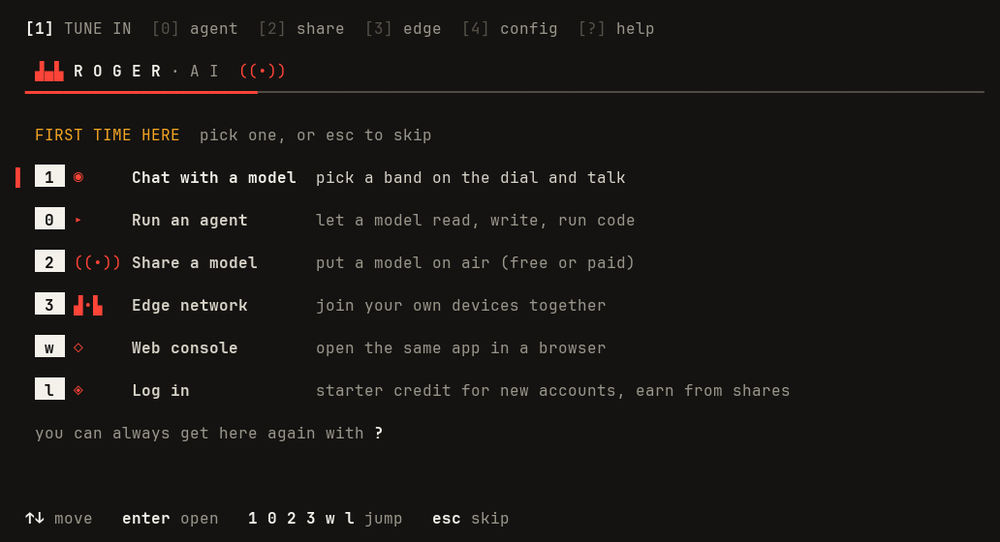
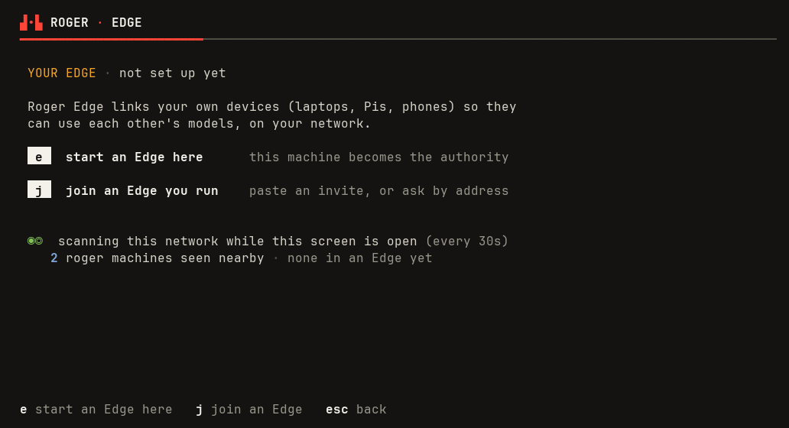

# Welcome card and empty Edge: mockups

Proposed 2026-10-11, for founder approval alongside the specs:
- /home/luis/rogerai-wt/simple-join/features/onboarding/welcome_card.feature
- /home/luis/rogerai-wt/simple-join/features/edge/empty_edge_simple.feature

These were rendered with the real `internal/fleetview` palette and helpers (the limoni look of the
Edge Health and Fleet screens: brand row and red rule, amber eyebrow, paper key caps, the one red,
the magic-eye glyph, the action bar) through limoni's own `uitest` harness at fixed widths. The
colour images were captured from the same screens running live in a 100x24 terminal. The
throwaway renderer was not committed.

## Welcome card (inside the TUI, first launch only)

Colour, 100 columns: /home/luis/rogerai-wt/simple-join/docs/welcome-card-mockup.png



100 columns:

```
 [1] TUNE IN  [0] agent  [2] share  [3] edge  [4] config  [?] help

  ▟▄▙ R O G E R · A I  ((•))
 ━━━━━━━━━━━━━━━━━━━━━━━━───────────────────────────────────────────────────────────────────────────

  FIRST TIME HERE  pick one, or esc to skip

▌  1  ◉     Chat with a model  pick a band on the dial and talk

   0  ▸     Run an agent       let a model read, write, run code

   2  ((•)) Share a model      put a model on air (free or paid)

   3  ▟•▙   Edge network       join your own devices together

   w  ◇     Web console        open the same app in a browser

   l  ◈     Log in             starter credit for new accounts, earn from shares

  you can always get here again with ?


 ↑↓ move   enter open   1 0 2 3 w l jump   esc skip
```

100 columns, third line selected (the red rail moves with the arrows):

```
 [1] TUNE IN  [0] agent  [2] share  [3] edge  [4] config  [?] help

  ▟▄▙ R O G E R · A I  ((•))
 ━━━━━━━━━━━━━━━━━━━━━━━━───────────────────────────────────────────────────────────────────────────

  FIRST TIME HERE  pick one, or esc to skip

   1  ◉     Chat with a model  pick a band on the dial and talk

   0  ▸     Run an agent       let a model read, write, run code

▌  2  ((•)) Share a model      put a model on air (free or paid)

   3  ▟•▙   Edge network       join your own devices together

   w  ◇     Web console        open the same app in a browser

   l  ◈     Log in             starter credit for new accounts, earn from shares

  you can always get here again with ?


 ↑↓ move   enter open   1 0 2 3 w l jump   esc skip
```

80 columns (nothing is cut):

```
 [1] TUNE IN  [0] agent  [2] share  [3] edge  [4] config  [?] help

  ▟▄▙ R O G E R · A I  ((•))
 ━━━━━━━━━━━━━━━━━━━━━━━━───────────────────────────────────────────────────────

  FIRST TIME HERE  pick one, or esc to skip

▌  1  ◉     Chat with a model  pick a band on the dial and talk

   0  ▸     Run an agent       let a model read, write, run code

   2  ((•)) Share a model      put a model on air (free or paid)

   3  ▟•▙   Edge network       join your own devices together

   w  ◇     Web console        open the same app in a browser

   l  ◈     Log in             starter credit for new accounts, earn from shares

  you can always get here again with ?


 ↑↓ move   enter open   1 0 2 3 w l jump   esc skip
```

60 columns (the description column drops; one line per option):

```
 [1] TUNE IN  [0] agent  [2] share  [3] edge  [4] config  [?

  ▟▄▙ R O G E R · A I  ((•))
 ━━━━━━━━━━━━━━━━━━━━━━━━───────────────────────────────────

  FIRST TIME HERE  pick one, or esc to skip

▌  1  ◉     Chat with a model
   0  ▸     Run an agent
   2  ((•)) Share a model
   3  ▟•▙   Edge network
   w  ◇     Web console
   l  ◈     Log in
  you can always get here again with ?


 ↑↓ move   enter open   1 0 2 3 w l jump   esc skip
```

## Empty Edge ([3] EDGE on a machine in no Edge)

Colour, 100 columns: /home/luis/rogerai-wt/simple-join/docs/empty-edge-mockup.png



100 columns:

```
 ▟•▙ ROGER · EDGE
 ━━━━━━━━━━━━━━━━━━━━━━━━───────────────────────────────────────────────────────────────────────────

  YOUR EDGE · not set up yet

  Roger Edge links your own devices (laptops, Pis, phones) so they
  can use each other's models, on your network.

   e   start an Edge here      this machine becomes the authority

   j   join an Edge you run    paste an invite, or ask by address


  ◉◎  scanning this network while this screen is open (every 30s)
     2 roger machines seen nearby · none in an Edge yet


 e start an Edge here   j join an Edge   esc back
```

80 columns:

```
 ▟•▙ ROGER · EDGE
 ━━━━━━━━━━━━━━━━━━━━━━━━───────────────────────────────────────────────────────

  YOUR EDGE · not set up yet

  Roger Edge links your own devices (laptops, Pis, phones) so they
  can use each other's models, on your network.

   e   start an Edge here      this machine becomes the authority

   j   join an Edge you run    paste an invite, or ask by address


  ◉◎  scanning this network while this screen is open (every 30s)
     2 roger machines seen nearby · none in an Edge yet


 e start an Edge here   j join an Edge   esc back
```

## Design choices to approve

- **Keys on the card are the TUI's real keys** (1 dial, 0 agent, 2 share, 3 edge, w console, l login), not 1 to 6, so the card teaches keys that keep working (welcome_card.feature DECISION 1).
- **One glyph per line, in the one red:** ◉ chat, ▸ agent, ((•)) share, ▟•▙ edge, ◇ console, ◈ login (DECISION 8).
- **Selection** is the red rail at the left, as in the Fleet rack.
- **The eyebrows** ("FIRST TIME HERE", "YOUR EDGE") are the amber the Fleet screen uses for things asking for attention.
- **No lamp on the empty Edge:** the ◉ ON AIR lamp in the brand row appears only once this machine is in an Edge (empty_edge_simple.feature DECISION 7).
- **The scan line** leads with the magic-eye glyph, green while scanning, as on Health.
- **The big ROGER·AI lockup** stays above the welcome card, unchanged.

## Follow-up: enrolled [3] look

Ruled 2026-10-11 (R1): this slice restyles only the welcome card and the empty [3] EDGE state.
The enrolled [3] view keeps its current look until this follow-up is specced and built:

- A brand band: `▟•▙ ROGER · EDGE` as a muted eyebrow row under the TUI's own brand, with the
  on-air lamp lit only when this machine is enrolled.
- The facts as eyebrow + ink rows (THIS MACHINE, AUTHORITY, DISCOVERY), the way Health lays out
  its readings.
- A key-cap action bar at the foot, the same helper the card and the empty state use.
- The map cards lose their borders for rails (a red rail on the selected card, dim otherwise).
- Session and map logic untouched: only the drawing changes.
- Goldens at 100x30 and 80x24, written from the TUI's View() with the golden helper this slice
  adds.
